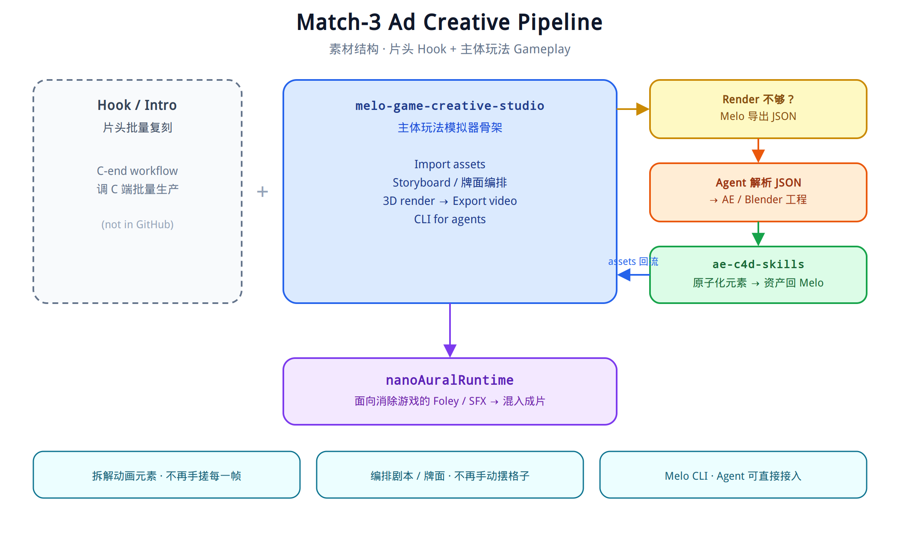

  <a href="https://github.com/dongyuan21">English</a> · <strong>简体中文</strong>

<h1 align="center">你好 👋，我是东远</h1>
<h3 align="center">用户增长工程师 | AI Agent 开发者 | 奥林匹克举重爱好者</h3>

  
  
  
  

---

### 🔭 正在做的事

- **消除类休闲游戏**：构建 [Melo](https://dongyuan21.github.io/melo-game-creative-studio/)（[源码](https://github.com/dongyuan21/melo-game-creative-studio)），用于素材导入、棋盘与玩法编排、3D 渲染和视频导出。
- **用户增长**：从 0 到 1 建设海外激励平台，涉及任务系统、裂变机制和 SEO 流量，并围绕 ROI、成本与资金损失控制持续迭代。
- **广告投放**：负责休闲游戏的 IAA 用户获取，结合消耗和 ROI 迭代广告素材。
- **AI Agent**：建设面向投放业务的只读 Data Agent，通过运行时约束、受治理 SQL 和可追溯依据输出分析报告。

### 📄 技术报告

**面向消除类游戏广告素材的可复用生产系统**  
*系统设计、实现与生产实践*  
Dongyuan Li、Yuwei Liu · 2026

**[中文版 PDF](https://github.com/dongyuan21/dongyuan21/blob/main/papers/melo-gcs-technical-report-zh.pdf)** · **[English PDF](https://github.com/dongyuan21/dongyuan21/blob/main/papers/melo-gcs-technical-report-en.pdf)**

两版均根据 2026 年 9 月 20 日最终稿重新排版，提供完整正文、目录和图表。配图为依据正文重绘的解释性示意图，未重现原始案例截图；具体说明见 PDF 首页。本页展示作者技术报告，不标注为 arXiv 已发表版本。

### 🎬 广告素材生产流程

一条投放素材由 **片头钩子 + 玩法正片** 组成。

**片头**通过面向用户的制作流程批量改编，这部分不在当前 GitHub 中。**玩法正片**基于 [melo-game-creative-studio](https://dongyuan21.github.io/melo-game-creative-studio/) 制作：导入素材、编排棋盘与玩法、进行 3D 渲染，再导出视频。Melo 同时提供 CLI，供 Agent 调用。

当浏览器渲染无法满足设计要求时，Melo 导出 JSON，由 Agent 转入 After Effects／Blender 原生工程继续制作。[ae-blender-skill](https://github.com/dongyuan21/ae-blender-skill) 支持专业源工程的处理，将其中适用的动画与素材整理为可复用元素，再用于 Melo 的后续制作。

这套循环希望减少两类重复劳动：**逐镜头手工调整动画**，以及 **逐个手工摆放棋盘和牌堆**。

消除类游戏的音效由 [nanoAuralRuntime](https://github.com/dongyuan21/nanoAuralRuntime) 生成。

  

  <a href="./creative-pipeline.excalidraw">查看 Excalidraw 图源</a>

### 💪 代码之外

- **奥林匹克举重**：抓举 **70 kg**｜挺举 **90 kg**｜高翻 **100 kg**。
- **篮球**：享受球场内外的团队协作 🏀。
- **个人理念**：*“在 AI 时代，审美判断与价值观尤为重要。”*

### 🌱 正在探索

- **从三消扩展到更多玩法**：扩展 Melo 的棋盘与玩法表达，复用已有渲染和导出流程。
- **创意与投放反馈闭环**：将消耗和 ROI 信号反馈到棋盘生成与镜头选择中。
- **Agent 批量出片**：让 Agent 端到端调用 Melo CLI，从一份创意需求派生多个编排版本。
